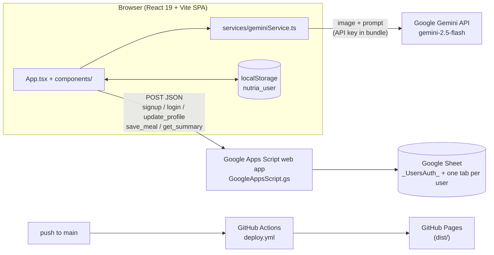
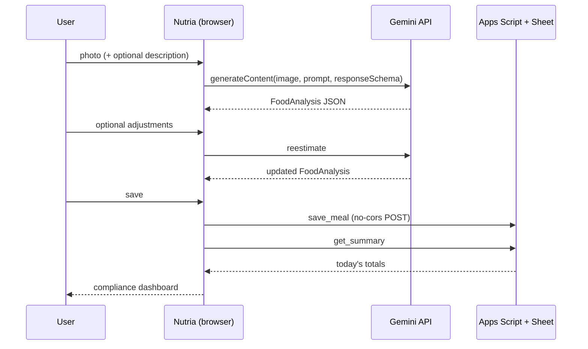

<div align="center">


# Nutria — Nutrición Inteligente

**Snap a photo of your meal and get a Costa Rica–aware nutritional breakdown from Google Gemini, logged to Google Sheets.**

[](https://vitejs.dev/)
[](https://react.dev/)
[](https://www.typescriptlang.org/)
[](https://tailwindcss.com/)
[](https://ai.google.dev/)

</div>

## Overview

**Nutria** (*Nutrición* + *IA*) is a single-page web app for food logging. The user takes or uploads a photo of a meal,
optionally adds a short description, and Gemini returns the dish name, portion size, estimated calories, main
ingredients and a breakdown into **food-group exchanges** (*harinas, vegetales, proteínas, frutas, leches, grasas*),
each with a short explanation. The prompt tells the model the user is in Costa Rica so local dishes (*gallo pinto*,
*casado*, …) are recognized by name.

Meals are saved to a Google Sheet through a Google Apps Script web app, one tab per user, and a daily dashboard compares
what was eaten today against the targets in the user's nutrition profile. The UI is in Spanish.

It is aimed at people following a food-exchange meal plan (as typically prescribed by a nutritionist) who want a quick
way to log meals from their phone.

## Features

- **Photo analysis** with `gemini-2.5-flash` and a JSON response schema (`services/geminiService.ts`).
- **Camera capture** on mobile (`capture="environment"`) or file upload.
- **Meal description** field to give the model extra context.
- **Re-estimation**: adjust the result and ask Gemini to recalculate (`reestimateFoodAnalysis`).
- **Photo timestamp**: the model is asked to return the EXIF `DateTimeOriginal` when present.
- **Accounts** (sign up / log in) stored in a hidden `_UsersAuth_` sheet; session kept in `localStorage`.
- **Nutrition profile** ("Mi Ficha"): daily exchange targets per food group, calories, water, weight and goal weight,
  exercise plan and notes.
- **Daily compliance dashboard**: today's totals per food group vs. profile targets (`get_summary`).
- **Per-user log tab** in the Google Sheet with date, dish, portion, calories, ingredients, exchanges and a resized
  image.
- Responsive layout with dark-mode styles; mobile-specific tweaks are listed in `MOBILE_OPTIMIZATIONS.md` (Spanish).

## Architecture





## Requirements

- Node.js 20 (the version used in CI) and npm.
- A Gemini API key from [Google AI Studio](https://aistudio.google.com/app/apikey).
- A Google account to host the Sheet and the Apps Script web app (only needed for login and saving).

## Installation and quick start

```bash
git clone https://github.com/Lapeyus/Nutria.git
cd Nutria
npm install
echo "VITE_GEMINI_API_KEY=<your-key>" > .env.local
npm run dev
# Vite dev server on http://localhost:3000 (bound to 0.0.0.0, so reachable from a phone on the same network)
```

### Google Sheets backend

1. Create a Google Sheet and open **Extensions → Apps Script**.
2. Paste the contents of `GoogleAppsScript.gs` and save.
3. **Deploy → New deployment → Web app**, execute as *Me*, access *Anyone*.
4. Put the resulting web app URL in the `GOOGLE_SHEET_URL` constant in `App.tsx`.

Every change to `GoogleAppsScript.gs` requires a **new deployment** to take effect. Step-by-step instructions (Spanish)
are in `DEPLOYMENT_INSTRUCTIONS.md`.

## Usage

1. Create an account or log in.
2. Fill in **Mi Ficha** with your daily targets.
3. Take or upload a meal photo, optionally describe it, and review the analysis.
4. Adjust and re-estimate if needed, then save.
5. Check the daily dashboard to see remaining exchanges per food group.

Scripts from `package.json`:

| Command | What it does |
| --- | --- |
| `npm run dev` | Vite dev server |
| `npm run build` | Production build into `dist/` |
| `npm run preview` | Serve the built `dist/` locally |
| `npm run deploy` | Build and add `dist/.nojekyll` |

## Repository structure

```text
Nutria/
├── App.tsx                      # App shell: auth state, analysis flow, save + daily summary; GOOGLE_SHEET_URL
├── index.tsx / index.html       # Entry point and HTML (PWA/mobile meta tags)
├── types.ts                     # UserProfile, User, FoodAnalysis, FoodSummary, ...
├── services/geminiService.ts    # Gemini client, prompts, response schema, analyze + re-estimate
├── components/
│   ├── ImageUploader.tsx        # Upload / camera capture
│   ├── AnalysisResult.tsx       # Result view, adjustments, save
│   ├── ComplianceDashboard.tsx  # Today's totals vs. targets
│   ├── ProfileView.tsx          # "Mi Ficha" nutrition profile
│   ├── Login.tsx                # Sign up / log in
│   ├── Header.tsx, Footer.tsx, icons/
├── GoogleAppsScript.gs          # Backend: doPost actions over the Google Sheet
├── public/                      # logo.png, favicon.png
├── index.css, mobile-optimizations.css, tailwind.config.js, postcss.config.js
├── vite.config.ts               # Port 3000, maps GEMINI key into process.env for compatibility
├── .github/workflows/deploy.yml # Build + deploy to GitHub Pages
├── DEPLOYMENT_INSTRUCTIONS.md   # Apps Script redeploy guide (Spanish)
├── GITHUB_SECRETS_INSTRUCTIONS.md # How to add the Gemini key as an Actions secret
└── MOBILE_OPTIMIZATIONS.md      # Notes on mobile UI work (Spanish)
```

## Configuration

| Name | Where | Purpose |
| --- | --- | --- |
| `VITE_GEMINI_API_KEY` | `.env.local` (local) / Actions secret (CI) | Gemini API key, inlined into the bundle at build time |
| `GEMINI_API_KEY` | optional fallback | Read by `vite.config.ts` if `VITE_GEMINI_API_KEY` is unset |
| `GOOGLE_SHEET_URL` | constant in `App.tsx` | Apps Script web app endpoint |

`.env.local` and other `*.local` files, `node_modules/` and `dist/` are git-ignored.

## Tests

There are no automated tests and no lint or type-check script in `package.json`.

## Deployment

`.github/workflows/deploy.yml` runs on every push to `main` (or manually): `npm ci`, `npm run build` with
`VITE_GEMINI_API_KEY` from repository secrets, then uploads `dist/` and deploys to GitHub Pages. Pages must be set to
the **GitHub Actions** source, and the secret must exist or the deployed app will report that the API key is not set
(see `GITHUB_SECRETS_INSTRUCTIONS.md`). `vite.config.ts` uses `base: '/'`, which fits a custom domain or a user site.

## Cost

Analysis uses Gemini Flash, which is inexpensive per image, and Google AI Studio's free tier covers light personal use.
Check current [Gemini API pricing](https://ai.google.dev/pricing) before running it for more users.

## Project status

Active personal project / prototype. Started December 2025; last commit February 2026.

## Known limitations

- **The Gemini API key is shipped to the browser.** Anyone using the deployed site can extract it; restrict the key
  (HTTP referrer, quotas) or move the call behind a backend before wider use.
- **Passwords are stored and compared in plain text** in the `_UsersAuth_` sheet, and the Apps Script endpoint is open to
  anyone with the URL. Treat the login as a convenience, not as security.
- Meals are saved with a `no-cors` request, so the app cannot detect save failures.
- The daily summary compares dates with the Apps Script server's locale and time zone.
- Food-group and calorie values are model estimates, not measurements.
- No LICENSE file; the previous README described the project as for educational and personal use.
